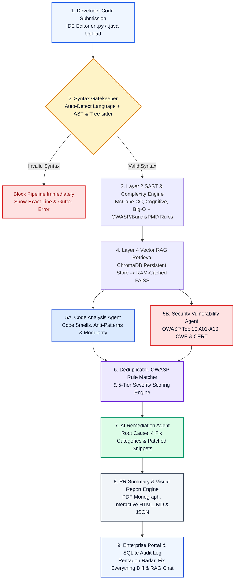
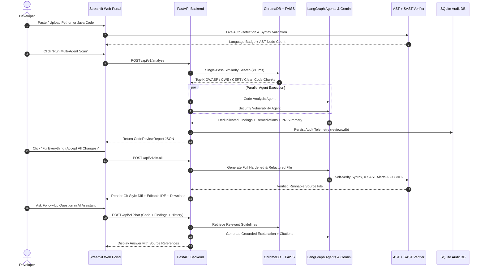

<div align="center">

# 🛡️ AI Code Review & Security Analysis Agent

**Enterprise Multi-Agent SAST, AST/Tree-sitter Code Inspection, Self-Verifying Automated Remediation, Executive Reporting & RAG Developer Assistant for Python and Java**

[](https://www.python.org/)
[](https://fastapi.tiangolo.com/)
[](https://streamlit.io/)
[](https://langchain-ai.github.io/langgraph/)
[](https://www.trychroma.com/)
[](https://github.com/PyCQA/bandit)
[](#-9-executive-report-generation--export-suite)

[Overview](#-1-overview--problem-statement) •
[Architecture](#-2-6-layer-system-architecture) •
[Workflow Diagrams](#-3-architecture--multi-agent-workflow-diagrams) •
[Agents](#-4-multi-agent-system--capabilities) •
[Benchmarks](#-5-end-to-end-benchmark-validation) •
[Quickstart](#-8-installation--quickstart) •
[API Docs](#-11-rest-api-specification)

</div>

---

## 🎯 1. Overview & Problem Statement

Software engineering teams struggle with inconsistent code quality, undetected security vulnerabilities, and slow, subjective manual code reviews. Developers rarely have immediate access to contextual secure coding guidelines during active development—allowing critical OWASP Top 10 vulnerabilities, hardcoded secrets, and high-complexity anti-patterns to reach production.

**AI Code Review & Security Analysis Agent** is a production-grade, 6-layer multi-agent platform for **Python** and **Java** that automates static code analysis, OWASP Top 10 security auditing, full-file automated code remediation, publication-grade PDF/HTML report generation, and RAG-grounded conversational assistance in **under 15–18 seconds**.

### ✨ Core Capabilities
* **IDE Code Scanner & Syntax Gatekeeper (`AST` + `Tree-sitter` + `streamlit-ace`)**: Auto-detects Python or Java from pasted code or uploaded `.py`/`.java` files, renders line numbers and syntax highlighting with gutter error annotations, and blocks syntactically broken code before invoking LLM agents.
* **Hybrid SAST + Parallel LangGraph Orchestration**: Combines deterministic static analysis (`Bandit`, `Semgrep`, `Pylint`, `Radon`, `SpotBugs`, `PMD`, `Checkstyle`) with parallel **Code Analysis** and **Security Vulnerability** agents grounded in **OWASP Top 10 (A01–A10)**, **CWE**, **SEI CERT**, and **Clean Code** standards.
* **Interactive Security & Quality Telemetry**: Features a 5-axis **Pentagon Radar Chart** (*Maintainability, Complexity Health, Documentation Coverage, Duplication Hygiene, Security Posture*), color-coded **5-Tier Severity Distribution**, and AST-computed per-function **McCabe Cyclomatic**, **Sonar Cognitive**, **Time**, and **Space** complexity metrics.
* **Self-Verifying "Fix Everything" Studio + Git Diff**: Generates a complete, runnable, refactored source file resolving security flaws and complexity bottlenecks in one click—automatically verified against the syntax gatekeeper and SAST rules—with a **Git-style Diff Viewer**, **Editable IDE Mode**, **Human-in-the-Loop approval tracking**, and clean fixed-file download.
* **Research-Grade Multi-Format Reports**: Exports visual **PDF Technical Audit Monographs** (embedded high-DPI charts, auto-wrapping tables, ISO/IEC 25010 metrics, Secure Coding Compliance Matrix, and before/after code boxes), self-contained **Interactive HTML Reports** (1-click Print-to-PDF), **Markdown PR Summaries**, and **JSON** payloads.
* **RAG Conversational Code Assistant**: Centered multi-turn developer chat powered by local **Sentence Transformers (`all-MiniLM-L6-v2`)**, persistent **ChromaDB**, and RAM-cached **FAISS** similarity search with source citations.

---

## 🏗️ 2. 6-Layer System Architecture

| Layer | Architectural Layer | Core Responsibilities & Technologies |
| :--- | :--- | :--- |
| **Layer 1** | **Code Input & Syntax Gatekeeper** | IDE editor (`streamlit-ace`) & `.py`/`.java` uploader. Auto-detects language and verifies grammar via Python `ast` and `Tree-sitter` (`tree-sitter-python`, `tree-sitter-java`). |
| **Layer 2** | **Static Analysis Engine (SAST)** | Sub-5ms in-memory AST complexity calculator (McCabe Cyclomatic, Sonar Cognitive, Time/Space Big-O) and deterministic SAST scanners covering OWASP A01–A10, Bandit, Semgrep, Pylint, Radon, SpotBugs, PMD, and Checkstyle. |
| **Layer 3** | **Multi-Agent AI Orchestration** | Coordinates parallel fan-out/fan-in detection, deduplication, severity scoring, remediation synthesis, and full-file refactoring using `LangGraph` (`StateGraph`) and `LangChain`. |
| **Layer 4** | **LLM Reasoning & Vector RAG** | Grounds `Google Gemini` (`gemini-2.5-flash`) in curated security docs stored persistently in `ChromaDB` and searched in <10ms via RAM-cached `FAISS` using `HuggingFaceEmbeddings` (`sentence-transformers/all-MiniLM-L6-v2`). |
| **Layer 5** | **Scoring, Remediation & Reporting** | Computes **Code Health Score (`0–100`)**, **Security Grade (`A–F`)**, Secure Coding Compliance Matrix, Git-style diffs, PR summaries, and visual **PDF / HTML / MD / JSON** reports (`fpdf2`, `Matplotlib`, `Plotly`). |
| **Layer 6** | **Enterprise Web Portal & Persistence** | Responsive 5-page `Streamlit` SaaS portal decoupled via a `FastAPI` REST backend (`Uvicorn`) with persistent historical audit logging in `SQLite3` (`data/reviews.db`). |

---

## 🔄 3. Architecture & Multi-Agent Workflow Diagrams

### A. End-to-End 6-Layer Pipeline & Parallel LangGraph Flow



### B. Full-File Self-Verifying Remediation & RAG Assistant Sequence



---

## 🧠 4. Multi-Agent System & Capabilities

### 1️⃣ Code Analysis Agent (`src/agents.py`)
Inspects structural quality, maintainability, and design patterns without executing the program:
* **Four Complexity Dimensions (`tools/static_analyzer.py`)**:
  * **McCabe Cyclomatic Complexity**: Computed per function/method via AST (ignoring comments/strings) and ranked `A` (Low Risk, $\le 5$) through `F`.
  * **Sonar Cognitive Complexity**: Penalizes nested control flow while rewarding flat guard clauses and modular decomposition.
  * **Asymptotic Time & Space Complexity**: Estimates Big-O execution and memory scaling ($\mathcal{O}(1)$, $\mathcal{O}(n)$, $\mathcal{O}(n^2)$, $\mathcal{O}(n^k)$).
* **Six Design Anti-Patterns**: *God Object*, *Spaghetti Code*, *Blob Class*, *Lava Flow*, *Golden Hammer*, and *Copy-Paste Programming*.
* **ISO/IEC 25010 Quality Telemetry**: *Composite Code Health Score (`0–100`)*, *Maintainability Index*, *Complexity Health*, *Duplication Hygiene*, *Documentation Coverage*, and *Technical Debt (minutes)*.

### 2️⃣ Security Vulnerability Agent (`src/agents.py`)
Combines deterministic SAST scanners with RAG-grounded LLM analysis across **all OWASP Top 10 (A01–A10)** categories and **CWE / SEI CERT / Bandit / SpotBugs** rules:
* **Full Coverage**: Broken Access Control (`A01`: CSRF, Path Traversal), Cryptographic Failures (`A02`: Hardcoded Secrets, MD5/SHA-1, weak PRNG), Injection (`A03`: SQLi, XSS, OS Command Injection, `eval`/`exec`), Insecure Design (`A04`), Security Misconfiguration (`A05`: Debug mode, TLS bypass, XXE), Vulnerable Components (`A06`), Authentication Failures (`A07`: unverified JWTs), Data Integrity Failures (`A08`: `pickle`/`ObjectInputStream`), Logging & Error Handling (`A09`: swallowed exceptions), and SSRF (`A10`).
* **Cross-Agent Deduplication**: Strict agent boundaries prevent the Code Analysis Agent from double-counting OWASP vulnerabilities on the same line, ensuring accurate severity counts and zero inflated technical debt.

### 3️⃣ AI Remediation Agent & Self-Verifying Full-File Fix Studio
* **Per-Finding Deep Dives**: Generates *Root Cause Analysis*, *Why It Occurs*, *4 Recommendation Categories* (*Security, Code Quality, Performance, Maintainability*), *Actionable Fix Steps*, and *Side-by-Side Flagged vs. Patched Code* with **Human-in-the-Loop** approval selectors.
* **"Fix Everything (Accept All Changes)" (`/api/v1/fix-all`)**: Rewrites the entire file to resolve all security flaws, decompose monolithic nested logic into modular helpers, eliminate magic numbers, and add docstrings. Every generated file passes through an automated **self-verification gate** checking syntax validity, zero residual SAST alerts, and Cyclomatic Complexity $\le 6$.

### 4️⃣ PR Summary Agent & Research-Grade Report Engine (`reports/report_generator.py`)
* Compiles executive verdicts (*Approved*, *Conditional Approval*, *Changes Requested*, or *Block Release*) with Security Grades (`A–F`) and phased `P0 / P1 / P2` roadmaps.
* Exports **4 synchronized formats** cached per scan in `st.session_state`:
  1. **Executive PDF Monograph (`.pdf`)**: Multi-page layout with running headers/footers, embedded high-DPI Pentagon Radar & Severity charts, auto-wrapping tables (zero text truncation), Secure Coding Compliance Matrix, and before/after code boxes.
  2. **Interactive HTML Report (`.html`)**: Self-contained monograph with Base64 PNG charts and `@media print` CSS for 1-click browser PDF export.
  3. **Markdown PR Report (`.md`)**: Copy-ready for GitHub/GitLab Pull Requests.
  4. **Structured JSON (`.json`)**: Machine-readable payload for CI/CD gates and SIEM archiving.

### 5️⃣ RAG-Powered Conversational Code Assistant
* Classifies developer query intent (*Vulnerability Explanation*, *Remediation & Secure Code*, *Code Smell Guidance*, *Static Warning Diagnosis*).
* Maintains multi-turn conversation memory tied to the active file and flagged findings, citing exact indexed knowledge base documents in every response.

---

## 📊 5. End-to-End Benchmark Validation

The platform includes **3 built-in benchmark samples of varying complexity** (Low, Medium, High) plus an automated validation suite (`tests/test_end_to_end.py`) verifying syntax detection, OWASP accuracy, self-verifying full-file remediation, RAG retrieval, and PDF report generation:

| Complexity Tier | Benchmark File | Language | Key Seeded Flaws & Anti-Patterns | Pre-Fix Score & Grade | Post-"Fix Everything" Re-Scan |
| :--- | :--- | :--- | :--- | :--- | :--- |
| **Low** | `token_utility.py` | Python | Hardcoded API secret (`CWE-798`), weak PRNG (`random.randint`), broken `MD5` hash (`CWE-328`) | **55–72 / 100 (Grade F)** | **95+ / 100 (Grade A, 0 findings)** |
| **Medium** | `auth_order_controller.py` | Python | Hardcoded JWT secret, SQLi (`CWE-89`), OS Command Injection (`shell=True`), `eval()` RCE (`CWE-95`), Spaghetti nesting (`Cog=16`), bare `except:` | **34.2 / 100 (Grade F, 160m debt)** | **96.3 / 100 (Grade A, 0 findings, CC 7→5, Cog 16→4, 0m debt)** |
| **High** | `EnterprisePaymentService.java` | Java | Hardcoded DB password, `MD5` PIN hashing (`CERT MSC61-J`), unclosed JDBC resource leak (`PMD CloseResource`), SQLi (`CERT IDS00-J`), 4-level nesting, empty `catch` block | **30–40 / 100 (Grade F)** | **90+ / 100 (Grade A, 0 findings)** |

Run the automated end-to-end validation suite:
```powershell
.\.venv\Scripts\python.exe tests/test_end_to_end.py
```

---

## 🛠️ 6. Technology Stack & Tooling Matrix

| Category | Tools & Libraries | Role in Platform |
| :--- | :--- | :--- |
| **Agent Orchestration** | `LangGraph`, `LangChain`, `Google Gemini` | Parallel multi-agent workflow, full-file refactoring, and RAG conversational assistant. |
| **Vector DB & Search** | `ChromaDB`, `FAISS` (`faiss-cpu`) | `ChromaDB` persists embeddings on disk; RAM-cached `FAISS` performs <10ms similarity search. |
| **Embeddings** | `Sentence Transformers`, `HuggingFaceEmbeddings` | Local CPU vector generation via `sentence-transformers/all-MiniLM-L6-v2` (zero API cost). |
| **Document Loaders** | `Unstructured`, `PyPDF`, `Markdown` | Ingests `.md` and `.pdf` security standards from `knowledge_base/`. |
| **Syntax & AST Parsing** | Python `ast`, `Tree-sitter` | Auto-detects Python/Java, counts syntax tree nodes, and blocks invalid syntax pre-LLM. |
| **SAST & Quality Rules** | `Bandit`, `Semgrep`, `Pylint`, `Radon`, `SpotBugs`, `PMD`, `Checkstyle` | Static security scanning, ISO/IEC 25010 quality metrics, and 4-dimensional complexity. |
| **Visualization & Reports** | `Plotly`, `Kaleido`, `Matplotlib`, `fpdf2` | Interactive 5-axis Pentagon Radar, color-coded Severity bars, high-DPI PDF & HTML reports. |
| **Frontend & Backend** | `Streamlit`, `streamlit-ace`, `FastAPI`, `Uvicorn`, `SQLite3`, `Pydantic` | 5-page enterprise web portal, IDE code editor, REST API, and SQLite audit history. |

---

## 📂 7. Repository Directory Structure

```text
ai-security-analysis-agent/
├── .streamlit/
│   └── config.toml                  # Enterprise Light Blue & White theme + watcher config
├── data/
│   ├── chroma_db/                   # Persistent ChromaDB vector store (gitignored)
│   └── reviews.db                   # SQLite audit history database (gitignored)
├── knowledge_base/                  # Curated Secure Coding & Quality Knowledge Base
│   ├── cert/                        # SEI CERT Oracle Secure Coding Standard for Java
│   ├── clean_code/                  # Clean Code, Refactoring & 6 Design Anti-Patterns
│   ├── cwe/                         # CWE Top Software Weaknesses specifications
│   ├── java/                        # PMD & SpotBugs Java static analysis rules
│   ├── owasp/                       # OWASP Top 10 (A01-A10) security guidelines
│   └── python/                      # Bandit & Python secure coding guidelines
├── llm/
│   ├── gemini_client.py             # Google Gemini ChatModel client with timeout management
│   └── prompt_manager.py            # Prompts for Code, Security, Remediation, Fix-All & Chat
├── models/
│   └── schemas.py                   # Pydantic models for scans, diffs, chat & reports
├── parsers/
│   ├── code_validator.py            # Auto Python/Java detector + AST & Tree-sitter gatekeeper
│   └── output_parser.py             # Resilient JSON array parser for structured agent output
├── rag/
│   ├── chroma_db.py                 # ChromaDB persistent client & vector store helpers
│   ├── chunking.py                  # RecursiveCharacterTextSplitter semantic chunker
│   ├── embeddings.py                # Singleton HuggingFaceEmbeddings (all-MiniLM-L6-v2)
│   ├── ingestion.py                 # Offline ETL pipeline to index knowledge_base/
│   ├── loader.py                    # UnstructuredMarkdownLoader (.md) & PyPDFLoader (.pdf)
│   └── retriever.py                 # In-memory cached FAISS search over ChromaDB vectors
├── reports/
│   └── report_generator.py          # Research-grade PDF, Executive HTML, MD & JSON generator
├── sample_codes/
│   ├── vulnerable_python_sample.py  # Python benchmark sample with known flaws
│   └── VulnerableJavaSample.java    # Java benchmark sample with known flaws
├── services/
│   ├── api.py                       # FastAPI backend (/health, /analyze, /fix-all, /chat, /history)
│   └── database.py                  # SQLite persistence layer for audit history
├── src/
│   ├── agents.py                    # All 5 AI agents, deduplicator & self-verifying fixer
│   ├── state.py                     # LangGraph ReviewWorkflowState TypedDict
│   └── workflow.py                  # Compiled LangGraph StateGraph orchestration pipeline
├── tests/
│   └── test_end_to_end.py           # End-to-end validation across 3 complexity tiers
├── tools/
│   └── static_analyzer.py           # AST McCabe/Cognitive complexity + in-memory SAST engine
├── ui/
│   ├── app.py                       # 5-page enterprise Streamlit portal + IDE editor + chat
│   └── charts.py                    # Plotly Pentagon Radar, Severity Bar & Git-Diff renderer
├── .env                             # Environment variables (gitignored)
├── .gitignore                       # Excludes .venv, .env, __pycache__, and *.db files
├── pyproject.toml                   # Project metadata and uv configuration
├── requirements.txt                 # Complete Python dependencies
└── README.md                        # Technical project documentation
```

---

## ⚙️ 8. Installation & Quickstart

### 1. Clone the Repository
```powershell
git clone https://github.com/Ganesh-978/ai-security-analysis-agent.git
cd ai-security-analysis-agent
```

### 2. Create & Activate Virtual Environment
```powershell
python -m venv .venv
.\.venv\Scripts\Activate.ps1
```

### 3. Install Dependencies
```powershell
.\.venv\Scripts\python.exe -m pip install -r requirements.txt
```

### 4. Configure Environment Variables (`.env`)
Create a `.env` file in the project root:
```env
GOOGLE_API_KEY=your_google_gemini_api_key_here
GEMINI_MODEL_NAME=gemini-2.5-flash
EMBEDDING_MODEL_NAME=sentence-transformers/all-MiniLM-L6-v2
CHROMA_PERSIST_DIR=./data/chroma_db
FAISS_INDEX_DIR=./data/faiss_index
```

### 5. Index the Secure Coding Knowledge Base
Run the offline ingestion pipeline once to chunk, embed, and store all `knowledge_base/` guidelines in ChromaDB:
```powershell
.\.venv\Scripts\python.exe rag/ingestion.py
```

---

## 🚀 9. Running the Platform

Launch the decoupled backend and frontend in two VS Code terminals inside the project root:

### Terminal 1 — FastAPI Backend Server
```powershell
.\.venv\Scripts\python.exe -m uvicorn services.api:app --host 127.0.0.1 --port 8000 --log-level warning
```
* **API Base URL**: `[http://127.0.0.1:8000](http://127.0.0.1:8000)`
* **Interactive Swagger Docs**: `[http://127.0.0.1:8000/docs](http://127.0.0.1:8000/docs)`

### Terminal 2 — Enterprise Streamlit Web Portal
```powershell
.\.venv\Scripts\python.exe -m streamlit run ui/app.py --server.fileWatcherType none --browser.gatherUsageStats false --logger.level error
```
* **Web Portal URL**: `http://localhost:8501`

---

## 🖥️ 10. Final Demonstration Walkthrough (5-Page Portal)

1. **🔍 Code Scanner (IDE Editor & Syntax Gatekeeper)**:
   * Load any of the 3 built-in benchmark samples (*Low Python*, *Medium Python*, *High Java*) or upload a `.py`/`.java` file.
   * Observe live **Python/Java auto-detection**, line numbers, syntax highlighting, and AST node counts.
   * Remove a `:` or `;` to demonstrate the **Syntax Gatekeeper** flagging the exact line in the editor gutter and blocking execution before LLM agents are triggered.
2. **📊 Review Dashboard (Visual Analytics & Unified Findings)**:
   * Run the scan (~10–17s) to inspect the **Code Health Score (`0–100`)**, **Security Grade (`A–F`)**, **5-Axis Pentagon Radar Chart**, **Color-Coded Severity Distribution**, complexity telemetry pills, deduplicated findings, and **PR Review Summary**.
3. **🛠️ Remediation Studio ("Fix Everything" + Git Diff + HITL Approval)**:
   * Click **✨ Fix Everything (Accept All Changes)** to generate a complete, self-verified patched source file.
   * Toggle between the **Git-Style Diff View** (`+additions / -deletions`) and **Editable Fixed Code** (`streamlit-ace`), download the clean file, or click **🔄 Load Fixed Code into Scanner** to re-scan and verify the jump to **90+/100 (Grade A, 0 findings)**.
4. **💬 AI Code Assistant (Multi-Turn RAG Chat)**:
   * Click a quick-ask chip or type a custom question about flagged vulnerabilities; inspect the intent classification, grounded code examples, and cited OWASP/CERT sources.
5. **📄 Reports & History (Executive Export Center)**:
   * Preview the interactive HTML report live and download the **Executive PDF Monograph (`.pdf`)**, **Interactive HTML (`.html`)**, **Markdown (`.md`)**, or **JSON (`.json`)**, plus review past scans persisted in `data/reviews.db`.

---

## 🔌 11. REST API Specification

| Method | Endpoint | Description |
| :--- | :--- | :--- |
| `GET` | `/health` | Returns backend liveness status (`{"status": "ok"}`). |
| `POST` | `/api/v1/analyze` | Validates syntax, runs SAST + Parallel Code & Security Agents + OWASP Rule Matcher + Remediation Agent + PR Summary Agent, saves to SQLite, and returns `CodeReviewReport`. |
| `POST` | `/api/v1/fix-all` | Runs the self-verifying full-file remediation engine (`AST` + `SAST` verified) and returns `FullFileFixResponse` containing the complete hardened source file. |
| `POST` | `/api/v1/chat` | Processes multi-turn developer queries via RAM-cached FAISS retrieval over ChromaDB and returns `AssistantQueryResponse` with intent and source citations. |
| `GET` | `/api/v1/history` | Returns the most recent code review audit records persisted in `data/reviews.db`. |

---

## 📈 12. Agile Project Milestones

* ✅ **Milestone 1 (Weeks 1–2) — Foundation, Syntax Gatekeeper & OWASP RAG Pipeline**
  * Designed 6-layer system architecture and Pydantic data models (`models/schemas.py`).
  * Implemented Code Submission Module with automatic Python/Java detection and syntax validation (`parsers/code_validator.py`).
  * Built Secure Coding Knowledge Base & RAG pipeline using `Unstructured`, `PyPDF`, `Sentence Transformers`, `ChromaDB`, and `FAISS` (`rag/`).
* ✅ **Milestone 2 (Weeks 3–4) — SAST Engine & Parallel Multi-Agent Orchestration**
  * Integrated `Tree-sitter` and AST complexity/SAST analysis (`tools/static_analyzer.py`).
  * Built parallel `Code Analysis Agent` and `Security Vulnerability Agent` orchestrated via `LangGraph` (`src/agents.py`, `src/workflow.py`) with `FastAPI` (`services/api.py`) and `SQLite` (`services/database.py`).
* ✅ **Milestone 3 (Weeks 5–6) — Remediation Agent, PR Summary, Dashboard & RAG Assistant**
  * Built `AI Remediation Agent` with root-cause analysis, 4 fix categories, side-by-side diffs, and Human-in-the-Loop controls.
  * Built `PR Summary Agent`, severity analytics dashboard, and multi-turn `RAG Conversational Code Assistant` (`/api/v1/chat`), optimizing latency via RAM-cached FAISS indexing.
* ✅ **Milestone 4 (Weeks 7–8) — Executive PDF/HTML Reports, Full-File Auto-Fix, UI Overhaul & Validation**
  * Upgraded to a 5-page enterprise web portal (`ui/app.py`) with an IDE code editor (`streamlit-ace`), Plotly 5-Axis Pentagon Radar, and color-coded Severity charts (`ui/charts.py`).
  * Added self-verifying **"Fix Everything"** full-file refactoring (`/api/v1/fix-all`) with Git-style diff viewer and clean fixed-file export.
  * Built publication-grade **PDF Monograph** & **Executive HTML Report** generator (`reports/report_generator.py`) with embedded high-DPI charts, compliance matrices, and auto-wrapping tables.
  * Completed end-to-end automated testing (`tests/test_end_to_end.py`) across 3 complexity tiers and finalized technical documentation.